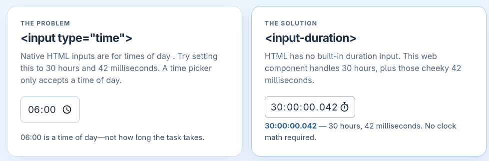
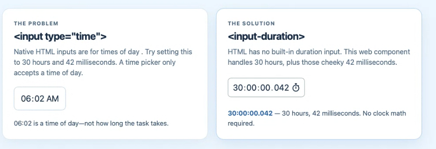
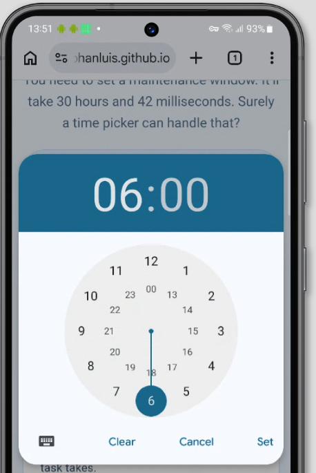
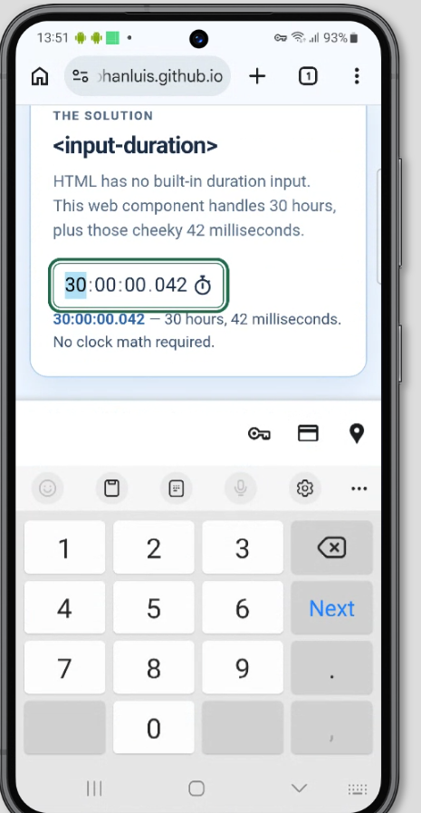
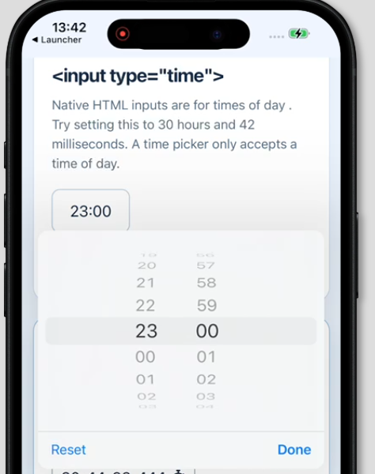
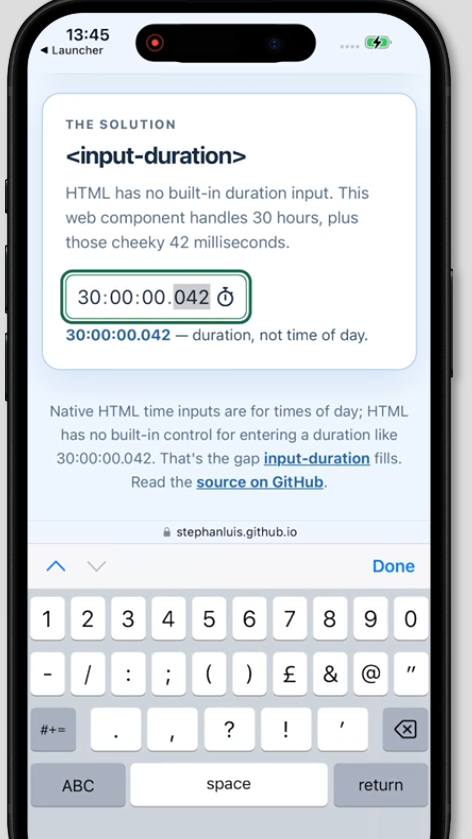
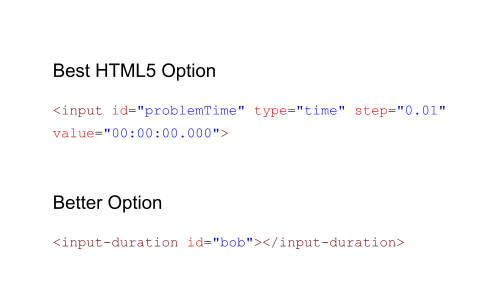

<div id="top"></div>

<!--
*** Thanks for checking out the Best-README-Template. If you have a suggestion
*** that would make this better, please fork the repo and create a pull request
*** or simply open an issue with the tag "enhancement".
*** Don't forget to give the project a star!
*** Thanks again! Now go create something AMAZING! :D
-->


<!-- PROJECT SHIELDS -->
<!--
*** I'm using markdown "reference style" links for readability.
*** Reference links are enclosed in brackets [ ] instead of parentheses ( ).
*** See the bottom of this document for the declaration of the reference variables
*** for contributors-url, forks-url, etc. This is an optional, concise syntax you may use.
*** https://www.markdownguide.org/basic-syntax/#reference-style-links
-->

[![npm bundle size][npm-bundle-size]][npm-bundle-size]
[![Contributors][contributors-shield]][contributors-url]
[![Forks][forks-shield]][forks-url]
[![Stargazers][stars-shield]][stars-url]
[![Issues][issues-shield]][issues-url]
[![MIT License][license-shield]][license-url]
[![RepoSize][reposize-shield]][reposize-url]


<!-- PROJECT LOGO -->
<br />
<div align="center">
  
  
  <a href="https://github.com/StephanLuis/input-duration">
   <h3 align="center">Input-Duration -- JavaScript duration input</h3> 
  </a>

  

  <p align="center">A compact duration input with a fixed, locale-independent display for hours, minutes, seconds, and milliseconds.</p>
</div>

Use `input-duration` when users need to enter a duration rather than a time of day: for example, a countdown, elapsed-time limit, or media offset. Its default display uses `HH:mm:ss.SSS` on every locale, without a locale-specific AM/PM presentation, and supports durations up to 99 hours. An optional days field supports longer durations.

HTML's built-in `<input type="time">` is for choosing a time of day, not entering elapsed time. HTML does not provide a native duration input with a fixed `HH:mm:ss.SSS` format or support for values over 24 hours; this web component fills that gap.

The component supplies its own segmented layout instead of the browser's native time-picker UI, so the displayed format does not change with browser or locale. It is built from native number inputs, however, so details such as the on-screen keyboard and interaction can still vary by device and browser; this is consistency of the value's presentation, not a guarantee of pixel-identical rendering. Milliseconds can be entered as three digits; the input's step controls increment in 10 ms intervals.

The control's styles are scoped inside its Shadow DOM, so global styles and resets from Tailwind or other CSS libraries do not leak into its internal layout. The control inherits its font and text color from its surrounding page.

## Quick start

Install the package and import it once to register the custom element:

```sh
npm install input-duration
```

```js
import 'input-duration';
```

```html
<input-duration value="01:23:45.678"></input-duration>
```

TypeScript declarations are included. See the [framework examples](#framework-examples) for React, Vue, Angular, and Svelte, or try the [manual import demos](#installation).

<br>
<p align="center">
  <a href="https://stephanluis.github.io/input-duration/" target="_blank">Demo</a> &middot;
  <a href="https://stephanluis.github.io/input-duration/bootstrap.html" target="_blank">Bootstrap Demo</a> &middot;
  <a href="https://stephanluis.github.io/input-duration/days-demo.html" target="_blank">Days Demo</a> &middot;
  <a href="https://cdn.jsdelivr.net/gh/StephanLuis/input-duration@main/docs/days-demo.html" target="_blank">Days Demo on jsDelivr</a> &middot;
  <a href="https://codesandbox.io/s/peaceful-waterfall-6mxpg2?file=/index.html" target="_blank">Fiddle</a> &middot;
  <a href="https://6mxpg2.csb.app/" target="_blank">Fiddle's Output</a> &middot;
  <a href="https://stephanluis.github.io/input-duration/InputDuration.html" target="_blank">API Docs</a> &middot;
  <a href="https://github.com/StephanLuis/input-duration/issues">Bugs</a> &middot;
  <a href="https://github.com/StephanLuis/input-duration/issues">Request Feature</a>
</p>
<br/>

<h2>Fixed-format duration input</h2>

`input-duration` is intended for touch and keyboard use. Typing a complete unit advances to the next unit; if that next unit is hidden, focus leaves the control. The HTML structure and displayed field order are controlled by the component; device-specific input and keyboard behavior remains native to the browser.

<h2>Bob is rescued by INPUT-DURATION!</h2>

The goal is a small JavaScript duration input that gives countdowns and elapsed-time entry a predictable displayed format across browser and locale settings, while retaining native numeric inputs for editing.

<i>Does this lose any functionality?</i> No! `document.querySelector('#bob').value` has a getter and setter, so values can be set and retrieved from JavaScript or the HTML attribute.

### Screenshots

The desktop comparisons show how a native time input represents a time of day, while `input-duration` displays an elapsed duration in a fixed format.

<p> 💔 the native time input on the left; 🏁 `input-duration` is shown on the right.</p>

<h4>Chrome</h4>


<h4>Safari</h4>


The mobile screenshots show the native time picker alongside `input-duration` on each platform.

<table>
  <thead>
    <tr>
      <th>Device</th>
      <th> 💔 Native time input<br/></th>
      <th> 🏁 input-duration</th>
    </tr>
  </thead>
  <tbody>
    <tr>
      <th>Android</th>
      <td></td>
      <td></td>
    </tr>
    <tr>
      <th>iOS</th>
      <td></td>
      <td></td>
    </tr>
  </tbody>
</table>

Native time inputs are useful when the user is choosing a time on a clock. A duration is different: `30:00:00.125` means thirty hours, not 6 AM the next day. Keeping those concepts separate avoids date, timezone, and 12/24-hour display concerns when collecting a duration.

Here's why:
* Enter durations independently of a calendar date or time of day.
* Keep a fixed `HH:mm:ss.SSS` display regardless of locale-specific clock conventions.
* Represent durations beyond 24 hours (up to 99 hours in the current implementation).
* Read and set the value from JavaScript using the component's `.value` property.

<!-- TABLE OF CONTENTS -->
<details>
  <summary>Table of Contents</summary>
  <ol>
    <li><a href="#quick-start">Quick start</a></li>
    <li>
      <a href="#about-the-project">About The Project</a>
      <ul>
        <li><a href="#built-with">Built With</a></li>
      </ul>
    </li>
    <li>
      <a href="#getting-started">Getting Started</a>
      <ul>
        <li><a href="#prerequisites">Prerequisites</a></li>
        <li><a href="#installation">Installation</a></li>
      </ul>
    </li>
    <li>
      <a href="#usage">Usage</a>
      <ul>
        <li><a href="#framework-examples">Framework examples</a></li>
      </ul>
    </li>
    <li><a href="#roadmap">Roadmap</a></li>
    <li><a href="#related-duration-controls">Related duration controls</a></li>
    <li><a href="#future-partners">Future partners</a></li>
     <li><a href="#cross-browser-testing">Cross-browser testing</a></li>
    <li><a href="#contributing">Contributing</a></li>
    <li><a href="#license">License</a></li>
    <li><a href="#contact">Contact</a></li>
    <li><a href="#acknowledgments">Acknowledgments</a></li>
  </ol>
</details>


<!-- ABOUT THE PROJECT -->
## About The Project

HTML's `<input type="time">` represents a time of day. Browsers may localize its visible control (for example, showing a 12-hour clock with AM/PM), even though its value is standardized. It also cannot represent a duration longer than a day.

`input-duration` is for duration values, not appointments or clock times. Its separate numeric fields present hours, minutes, seconds, and milliseconds in a fixed `HH:mm:ss.SSS` format by default. An optional days field supports longer durations. This avoids locale-dependent time-of-day presentation while allowing millisecond values in a compact control.

<!-- [![Product Name Screen Shot][product-screenshot]](https://example.com) -->



<!-- [![HTML Screen Shot][html-screenshot]](https://example.com) -->
<p align="right">(<a href="#top">back to top</a>)</p>


### Built With


* [Node.js](https://nodejs.org/)
* [Codespaces](https://github.com/features/codespaces)
* [Testing Powered By SauceLabs](https://saucelabs.com)
* [Selenium](https://www.selenium.dev/)

input-duration is a module and works with webpack. Any add-ons/plugins used in dev are in the acknowledgements section.

<p align="right">(<a href="#top">back to top</a>)</p>


<!-- GETTING STARTED -->
## Getting Started

There are no pre-requisites for using input-duration if you're not compiling/ packaging you javascript.  If you are packaging:

### Prerequisites

This is an example of how to get started with npm and webpack, other frameworks should work too.
* npm & webpack
  ```sh
  npm install npm@latest -g
  npm init -y
  npm install webpack webpack-cli --save-dev
  ```

### Installation

With packaging:
_This template doesn't rely on any external dependencies or services._

1. Install from NPM
 ```sh
  npm i input-duration
 ```
2. import input-duration in javascript
 ```sh

 import 'input-duration';

```
The package includes TypeScript declarations and registers the `<input-duration>` element when imported. Its typed DOM element is available from `document.querySelector('input-duration')`.
  
Without packaging:

1. Add script:
 ```sh

<script type="module">

import id from 'https://cdn.jsdelivr.net/npm/input-duration/+esm'
        
 </script>
  
 ```

For manual browser checks, serve the repository root and open the [local package-specifier import demo](Tests/Manual/manTestLocalModule%20copy.html), the [jsDelivr ESM import demo](Tests/Manual/manTestJSdelivrModule.html), or the [unit combinations test page](Tests/Manual/unit-combinations.html). The unit test page covers all 16 visible/hidden combinations of hours, minutes, seconds, and milliseconds, plus days mode with `dayFriendlyValue`. The [days display and value demo](https://stephanluis.github.io/input-duration/days-demo.html) is published on GitHub Pages and loads the package from jsDelivr; the source page is also available [through jsDelivr](https://cdn.jsdelivr.net/gh/StephanLuis/input-duration@main/docs/days-demo.html). Browsers do not resolve npm package names themselves, so the local demos use an import map to resolve `input-duration` to the local module; bundlers resolve the package name through `package.json` exports.

<p align="right">(<a href="#top">back to top</a>)</p>


<!-- USAGE EXAMPLES -->
## Usage

input-duration requires a `<input-duration>` element .  There's no more HTML than that, but don't forget the closing tag.  Native Input elements don't have them!
```sh

<input-duration id='bob'></input-duration>

```

Individual duration fields can be hidden with boolean attributes:

```html
<input-duration no-hours no-minutes no-seconds no-microseconds></input-duration>
```

The days field is hidden by default. Add `show-days` or call `showDays()` to display it. In days mode, hours range from `00` to `23` and roll over into days; dividers default to `d `, `h `, and `m `, followed by the decimal point and `s` suffix. The `.value` format becomes `D:HH:mm:ss.SSS` in days mode, such as `2:03:04:05.006`; legacy `HH:mm:ss.SSS` values continue to work and are normalized when days are shown. Call `hideDays()` to hide the field. Hiding a nonzero days field preserves its value and extended `.value` representation.

The read-only `.dayFriendlyValue` property returns a normalized, labeled string such as `2d 03h 04m 05.006s`, including when the days field is hidden.

Use `hideHours()`, `hideMinutes()`, `hideSeconds()`, and `hideMicroSeconds()` to hide fields, and the corresponding `show*()` methods to show them again. The existing `noHours()`, `noMinutes()`, `noSeconds()`, and `noMicroSeconds()` methods remain available as aliases for the `hide*()` methods. Hidden fields do not change the component's value.

Customize the separators with the `days-divider`, `hours-divider`, `minutes-divider`, `seconds-divider`, and `microseconds-divider` attributes. A single separator is shown between each pair of visible units, even if units in between are hidden; the separator associated with the left visible unit is used. The first four attributes customize those separators; `microseconds-divider` adds an optional suffix after milliseconds. For example:

```html
<input-duration show-days days-divider="d " hours-divider="h " minutes-divider="m " seconds-divider="." microseconds-divider="s"></input-duration>
```

The equivalent methods are `setDaysDivider(text)`, `setHoursDivider(text)`, `setMinutesDivider(text)`, `setSecondsDivider(text)`, and `setMicroSecondsDivider(text)`. Pass text as a string; it is rendered as text, not HTML. Remove an attribute to restore its default separator (or remove the milliseconds suffix).

If you would like to get or set values or to disable input-duration elemet, javascipt can do that: 

```sh

document.querySelector('#bob').value = '44:04:04.444'

``` 

### HTML form submission, validation, disabled state, and reset

On browsers that support form-associated custom elements, give the component a `name` to include its `HH:mm:ss.SSS` value in form submission. Add `required` to require an explicitly set or committed user-edited duration. The untouched zero display is treated as empty for required validation; a supplied `value`, including `00:00:00.000`, satisfies `required`.

```html
<form action="/save" method="post">
  <label for="duration">Duration</label>
  <input-duration id="duration" name="duration" value="01:23:45.678" required></input-duration>
  <button type="submit">Save</button>
  <button type="reset">Reset</button>
</form>
```

The submitted form field is `duration=01:23:45.678` in the default format, or `duration=2:03:04:05.006` when days are enabled. While a field is being edited, `.value` and form submission retain the last committed duration; edits are committed when the field changes (typically when it loses focus), after single-digit fields are normalized. The `disabled` attribute disables the internal fields and excludes the component from submission; the `disable()` and `enable()` methods are also available. A form reset restores the `value` attribute, or the zero display when no default value is provided. In browsers that support form-associated custom elements and restore form state, the component also restores the saved duration and whether it had been explicitly set.

### Bootstrap styling

The component keeps its Shadow DOM, so Bootstrap's CSS selectors do not directly style its internal fields. Instead, map Bootstrap theme variables to the component's CSS custom properties. This is additive: without overrides, the component retains its default appearance.

```css
input-duration {
  --input-duration-border-color: var(--bs-border-color);
  --input-duration-border-radius: var(--bs-border-radius);
  --input-duration-background: var(--bs-body-bg);
  --input-duration-color: var(--bs-body-color);
  --input-duration-focus-color: var(--bs-primary);
  --input-duration-focus-outline: 0.25rem solid rgba(var(--bs-primary-rgb), 0.25);
}
```

The internal control and its fields, dividers, and icon are also exposed as Shadow Parts for targeted styling:

```css
input-duration::part(control) {
  padding: 0.375rem 0.75rem;
}

input-duration::part(field) {
  font-size: 1rem;
}
```

Available parts are `control`, `field` (also `field-days`, `field-hours`, `field-minutes`, `field-seconds`, and `field-milliseconds`), `divider` (also `divider-days-hours`, `divider-hours-minutes`, `divider-minutes-seconds`, and `divider-seconds-milliseconds`), and `icon`. Supported CSS custom properties are `--input-duration-gap`, `--input-duration-padding`, `--input-duration-border-color`, `--input-duration-border-radius`, `--input-duration-background`, `--input-duration-color`, `--input-duration-focus-color`, `--input-duration-focus-outline`, `--input-duration-focus-outline-offset`, `--input-duration-invalid-color`, `--input-duration-divider-color`, `--input-duration-divider-opacity`, `--input-duration-disabled-color`, and `--input-duration-icon-color`.

and

```sh

document.querySelector('#bob').disable()

```
so the inputs are modified.

For the generated JSDoc API reference, see the [input-duration API documentation](https://stephanluis.github.io/input-duration/InputDuration.html).

### Framework examples

Install the package in your project:

```sh
npm install input-duration
```

Import it once in the app entry point or component file. The module registers the `<input-duration>` custom element. Each example reads its value with a framework reference when the button is clicked.

#### React

```jsx
import { useRef, useState } from 'react';
import 'input-duration';

export function DurationExample() {
  const durationRef = useRef(null);
  const [duration, setDuration] = useState('');

  return (
    <div>
      <input-duration ref={durationRef} value="01:23:45.678"></input-duration>
      <button
        type="button"
        onClick={() => setDuration(durationRef.current.value)}
      >
        Read duration
      </button>
      <output>{duration}</output>
    </div>
  );
}
```

#### Vue 3

```vue
<script setup>
import { ref } from 'vue';
import 'input-duration';

const durationInput = ref(null);
const duration = ref('');

function readDuration() {
  duration.value = durationInput.value.value;
}
</script>

<template>
  <div>
    <input-duration ref="durationInput" value="01:23:45.678"></input-duration>
    <button type="button" @click="readDuration">Read duration</button>
    <output>{{ duration }}</output>
  </div>
</template>
```

#### Angular

```ts
import { Component, CUSTOM_ELEMENTS_SCHEMA, ElementRef, ViewChild } from '@angular/core';
import 'input-duration';

type InputDurationElement = HTMLElement & { value: string };

@Component({
  selector: 'app-duration-example',
  standalone: true,
  schemas: [CUSTOM_ELEMENTS_SCHEMA],
  template: `
    <input-duration #durationInput value="01:23:45.678"></input-duration>
    <button type="button" (click)="readDuration()">Read duration</button>
    <output>{{ duration }}</output>
  `
})
export class DurationExampleComponent {
  @ViewChild('durationInput', { static: true })
  durationInput!: ElementRef<InputDurationElement>;

  duration = '';

  readDuration() {
    this.duration = this.durationInput.nativeElement.value;
  }
}
```

#### Svelte

```svelte
<script>
  import 'input-duration';

  let durationInput;
  let duration = '';

  function readDuration() {
    duration = durationInput.value;
  }
</script>

<div>
  <input-duration bind:this={durationInput} value="01:23:45.678"></input-duration>
  <button type="button" on:click={readDuration}>Read duration</button>
  <output>{duration}</output>
</div>
```

After an edited field changes, the component commits and normalizes its value, then dispatches a bubbling `change` event from the host element. Listen for `change` to read the updated `.value` or `.dayFriendlyValue`; during `input`, those properties continue to report the last committed duration. For native form submission, add a `name` attribute as shown in [HTML form submission](#html-form-submission).

<p align="right">(<a href="#top">back to top</a>)</p>


<!-- ROADMAP -->
## Roadmap

- [x] Emperically determine <input type="time"> behaviour of Input (time) on Chrome
- [x] Reverse engineer input behaviour (arrows, digits, 0 addition, etc.)
- [x] Cross browser/ cross os manual tests  
- [ ] Add end to end multi-browser, multi-os Selinium tests
- [X] Update demo page (either PM.com or JSfiddle type)
- [ ] Multi-language documentation (Google translate of this page?)
    - [ ] Chinese
    - [ ] Spanish

### 2026

- [ ] Document and verify a versioned Chrome `<input type="time">` behavior profile: compare the [WHATWG standard](https://html.spec.whatwg.org/multipage/input.html#time-state-(type=time)) with [Blink's implementation](https://chromium.googlesource.com/chromium/src/+/main/third_party/blink/renderer/core/html/forms/time_input_type.cc) and [time-input tests](https://chromium.googlesource.com/chromium/src/+/main/third_party/blink/web_tests/fast/forms/time/) (including [multiple-field UI tests](https://chromium.googlesource.com/chromium/src/+/main/third_party/blink/web_tests/fast/forms/time-multiple-fields/)). Record Chrome version, OS, and locale; verify relevant keyboard and segment-editing behavior, then adapt `input-duration` where appropriate without assuming platform-specific time-picker UI is universal.
- [x] Add an optional days field with 24-hour rollover, unit dividers, and `dayFriendlyValue`; keep `HH:mm:ss.SSS` as the default. ([html-duration-picker.js](https://nadchif.github.io/html-duration-picker.js/), [input-duration-element](https://muan.github.io/input-duration-element/))
- [ ] Support declarative minimum and maximum values with consistent validation and boundary behavior. ([html-duration-picker.js](https://nadchif.github.io/html-duration-picker.js/))
- [ ] Improve accessibility with per-segment labels, group semantics, and documented screen-reader and keyboard behavior. ([time-input-polyfill](https://github.com/Dan503/time-input-polyfill/) demonstrates accessible time-field interactions.)
- [x] Submit the duration through a `name` attribute in browsers that support form-associated custom elements.
- [x] Support required validation, field input filtering, disabled state, and form reset.
- [x] Support browser form state restoration, including the required/unset state.
- [ ] Offer optional ISO 8601 duration serialization and `Temporal.Duration` interoperability without breaking the existing `HH:mm:ss.SSS` value format. ([WHATWG discussion](https://github.com/whatwg/html/issues/5488#issuecomment-3961032394), [duration-input example](https://gist.github.com/Wigny/97cc83ea5179e7b8ab5a044fb14deb9a))

See the [open issues](https://github.com/StephanLuis/input-duration/issues) for a full list of proposed features (and known issues).

<p align="right">(<a href="#top">back to top</a>)</p>

<!-- RELATED DURATION CONTROLS -->
## Related duration controls

This comparison summarizes capabilities described in each project's documentation; a dash means the feature is not documented, not necessarily unsupported. "Estimated users" is approximated by npm package downloads from 2026-10-28 through 2026-11-03, not unique people; downloads can include CI, repeated installs, and automated systems, and omit CDN or other use. The Wigny entry is a gist example rather than a maintained library, so no npm download figure is available.

| Control | Display / units | Value representation | Bounds | Precision / interaction | Estimated users* |
|---|---|---|---|---|---:|
| [input-duration](https://github.com/StephanLuis/input-duration) | `HH:mm:ss.SSS` by default (00–99 hours); optional days via `show-days` | `HH:mm:ss.SSS` normally; `D:HH:mm:ss.SSS` with days | No public min/max options documented | Milliseconds; digit entry, arrow navigation and increment | [~748](https://api.npmjs.org/downloads/point/last-week/input-duration) |
| [timepoint-selection](https://github.com/naomiaro/timepoint-selection) | Selectable `dd:hh:mm:ss`, `dd:hh:mm`, `hh:mm:ss`, `hh:mm`, or `mm:ss`; custom unit labels | Numeric seconds through `getValue()` / `setValue()` | Configurable maximum / rollover | Seconds; keyboard navigation, arrow increments, rollover | [~22](https://api.npmjs.org/downloads/point/last-week/timepoint-selection) |
| [html-duration-picker.js](https://github.com/nadchif/html-duration-picker.js) | `HH:MM:SS`; optional hidden seconds | Formatted text in an enhanced native `<input>` | Configurable minimum and maximum durations | Seconds in documented formats; interaction details not specified | [~905](https://api.npmjs.org/downloads/point/last-week/html-duration-picker) |
| [muan/input-duration-element](https://github.com/muan/input-duration-element) | Hours, minutes, seconds; customizable dividers/slots | Numeric seconds; `value` and `change` event | `max` documented; `min` and validation listed as TODOs | Demo covers durations up to 180 seconds; precision beyond seconds not specified | [~9](https://api.npmjs.org/downloads/point/last-week/input-duration-element) |
| [segmented-input](https://github.com/jimmywarting/segmented-input) | Duration preset or custom parsing/formatting and segments | Formatted string in an enhanced native `<input>` | Per-segment `min`, `max`, and `step`; custom validity | Duration preset shown to seconds; arrow-key segment navigation and adjustment | [~4](https://api.npmjs.org/downloads/point/last-week/segmented-input) |
| [Wigny duration-input example](https://gist.github.com/Wigny/97cc83ea5179e7b8ab5a044fb14deb9a) | Markup-defined hour, minute, and second segments | ISO 8601 duration string; form-associated custom element | No public min/max API documented | Fractional seconds; keyboard segment navigation and adjustment | N/A (gist) |

These projects illustrate possible directions—such as optional units, configurable formatting, bounds, alternate value formats, and native form participation—without implying that every feature is a fit for `input-duration`.

<p align="right">(<a href="#top">back to top</a>)</p>

<!-- FUTURE PARTNERS -->
## Future partners

Potential integration targets only; these projects are not affiliated with or endorsing `input-duration`.

- [React Hook Form](https://react-hook-form.com/docs/usecontroller/controller) — provide a tested `Controller` adapter/example that synchronizes the custom element's value, events, ref, and validation.
- [Formik](https://formik.org/docs/api/field) — add a custom `Field` example to connect duration values to Formik-managed forms.
- [Angular Reactive Forms](https://angular.dev/api/forms/ControlValueAccessor) — provide a `ControlValueAccessor` adapter for model-to-view updates, user changes, touched state, and disabled state.
- [Shoelace](https://shoelace.style/) — document how to use the framework-agnostic duration element alongside Shoelace form controls in a consistent design system.

<p align="right">(<a href="#top">back to top</a>)</p>

<!-- TESTSTATUS -->
## Cross-browser testing

The browser and device results linked below are historical and should not be treated as verification against current browser versions. The local regression suite checks component behavior, but current cross-browser rendering and interaction still need to be tested.

[Tests & Live Status](https://github.com/StephanLuis/BrowserStackSelenium/blob/main/input-duration/README.md)


<!-- CONTRIBUTING -->
## Contributing

Contributions are what make the open source community such an amazing place to learn, inspire, and create. Any contributions you make are **greatly appreciated**.

Run the local regression tests with `npm test`.

If you have a suggestion that would make this better, please fork the repo and create a pull request. You can also simply open an issue with the tag "enhancement".
Don't forget to give the project a star! Thanks again!

1. Fork the Project
2. Create your Feature Branch (`git checkout -b feature/AmazingFeature`)
3. Commit your Changes (`git commit -m 'Add some AmazingFeature'`)
4. Push to the Branch (`git push origin feature/AmazingFeature`)
5. Open a Pull Request

<p align="right">(<a href="#top">back to top</a>)</p>


<!-- LICENSE -->
## License

Distributed under the MIT License. See [`LICENSE.txt`](https://github.com/StephanLuis/input-duration/blob/main/LICENSE)  for more information.

<p align="right">(<a href="#top">back to top</a>)</p>


<!-- CONTACT -->
## Contact

Stephan Luis - stephan@learnsense.org

Project Link: [https://github.com/StephanLuis/input-duration](https://github.com/StephanLuis/input-duration)

<p align="right">(<a href="#top">back to top</a>)</p>


<!-- ACKNOWLEDGMENTS -->
## Acknowledgments

Resources I've found helpful and would like to give credit to:


* [GitHub Pages](https://pages.github.com)
* [Font Awesome](https://fontawesome.com)
* [Best Readme](https://github.com/othneildrew/Best-README-Template)
* [Img Shields](https://shields.io)


<p align="right">(<a href="#top">back to top</a>)</p>


<!-- MARKDOWN LINKS & IMAGES -->
<!-- https://www.markdownguide.org/basic-syntax/#reference-style-links -->


[contributors-shield]: https://img.shields.io/github/contributors/StephanLuis/input-duration?style=for-the-badge
[contributors-url]: https://github.com/StephanLuis/input-duration/graphs/contributors
[forks-shield]: https://img.shields.io/github/forks/StephanLuis/input-duration?style=for-the-badge
[forks-url]: https://github.com/StephanLuis/input-duration/network/members
[stars-shield]: https://img.shields.io/github/stars/StephanLuis/input-duration?style=for-the-badge
[stars-url]: https://github.com/StephanLuis/input-duration/stargazers
[issues-shield]: https://img.shields.io/github/issues/StephanLuis/input-duration?style=for-the-badge
[issues-url]: https://github.com/StephanLuis/input-duration/issues
[license-shield]: https://img.shields.io/github/license/StephanLuis/input-duration?style=for-the-badge
[license-url]: https://github.com/StephanLuis/input-duration/blob/main/LICENSE
[reposize-shield]: https://img.shields.io/github/repo-size/stephanluis/input-duration?style=for-the-badge
[reposize-url]: https://github.com/StephanLuis/input-duration
[product-screenshot]: images/screenshot.png
[npm-bundle-size]: https://img.shields.io/bundlephobia/minzip/input-duration?style=for-the-badge
[teststatus-shield]: https://img.shields.io/badge/dynamic/json?url=https://app.saucelabs.com/u/stephanluis&label=Sauce%20Labs%20Status&color=brightgreen&style=for-the-badge&query=passing


[html-screenshot]: readme/html.png
[safari-screenshot]: readme/safariBad.png
