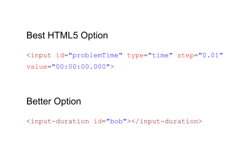
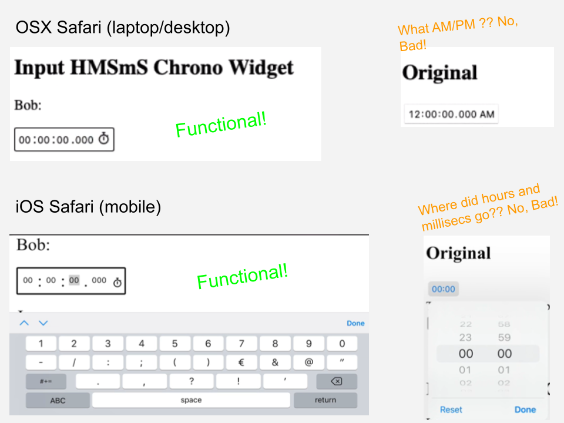

<div id="top"></div>

<!--
*** Thanks for checking out the Best-README-Template. If you have a suggestion
*** that would make this better, please fork the repo and create a pull request
*** or simply open an issue with the tag "enhancement".
*** Don't forget to give the project a star!
*** Thanks again! Now go create something AMAZING! :D
-->


<!-- PROJECT SHIELDS -->
<!--
*** I'm using markdown "reference style" links for readability.
*** Reference links are enclosed in brackets [ ] instead of parentheses ( ).
*** See the bottom of this document for the declaration of the reference variables
*** for contributors-url, forks-url, etc. This is an optional, concise syntax you may use.
*** https://www.markdownguide.org/basic-syntax/#reference-style-links
-->

[![npm bundle size][npm-bundle-size]][npm-bundle-size]
[![Contributors][contributors-shield]][contributors-url]
[![Forks][forks-shield]][forks-url]
[![Stargazers][stars-shield]][stars-url]
[![Issues][issues-shield]][issues-url]
[![MIT License][license-shield]][license-url]
[![RepoSize][reposize-shield]][reposize-url]


<!-- PROJECT LOGO -->
<br />
<div align="center">
  
  
  <a href="https://github.com/StephanLuis/input-duration">
   <h3 align="center">Input-Duration -- The best 'Time Only' Input (Vanilla JS)</h3> 
  </a>

  

  <p align="center">A compact duration input with a fixed, locale-independent display for hours, minutes, seconds, and milliseconds.</p>
</div>

Use `input-duration` when users need to enter a duration rather than a time of day: for example, a countdown, elapsed-time limit, or media offset. Its displayed value uses `HH:mm:ss.SSS` on every locale, without a locale-specific AM/PM presentation, and supports durations greater than 24 hours (currently up to 99 hours) with millisecond values, such as `30:00:00.125`.

The component supplies its own segmented layout instead of the browser's native time-picker UI, so the displayed format does not change with browser or locale. It is built from native number inputs, however, so details such as the on-screen keyboard and interaction can still vary by device and browser; this is consistency of the value's presentation, not a guarantee of pixel-identical rendering. Milliseconds can be entered as three digits; the input's step controls increment in 10 ms intervals.
<br>
<p>
<div>
  </div>
    <div align="center">
  <a href="https://codesandbox.io/s/peaceful-waterfall-6mxpg2?file=/index.html" target="_blank">
  Fiddle
</a> ·
      <a href="https://6mxpg2.csb.app/" target="_blank">Demo</a>
    ·
  <a href="https://stephanluis.github.io/input-duration/" target="_blank">Live demo</a>
    ·
  <a href="https://stephanluis.github.io/input-duration/" target="_blank">Docs</a>
  ·
    <a href="https://github.com/StephanLuis/input-duration/issues">Bugs</a>
    ·
    <a href="https://github.com/StephanLuis/input-duration/issues">Request Feature</a>
  </p>
  </div>
</div>
<br/>

<h2>Fixed-format duration input</h2>

`input-duration` is intended for touch and keyboard use. The HTML structure and displayed field order are controlled by the component; device-specific input and keyboard behavior remains native to the browser.

<!-- TABLE OF CONTENTS -->
<details>
  <summary>Table of Contents</summary>
  <ol>
    <li>
      <a href="#about-the-project">About The Project</a>
      <ul>
        <li><a href="#built-with">Built With</a></li>
      </ul>
    </li>
    <li>
      <a href="#getting-started">Getting Started</a>
      <ul>
        <li><a href="#prerequisites">Prerequisites</a></li>
        <li><a href="#installation">Installation</a></li>
      </ul>
    </li>
    <li><a href="#usage">Usage</a></li>
    <li><a href="#roadmap">Roadmap</a></li>
     <li><a href="#cross-browser-testing">Cross-browser testing</a></li>
    <li><a href="#contributing">Contributing</a></li>
    <li><a href="#license">License</a></li>
    <li><a href="#contact">Contact</a></li>
    <li><a href="#acknowledgments">Acknowledgments</a></li>
  </ol>
</details>


<!-- ABOUT THE PROJECT -->
## About The Project

HTML's `<input type="time">` represents a time of day. Browsers may localize its visible control (for example, showing a 12-hour clock with AM/PM), even though its value is standardized. It also cannot represent a duration longer than a day.

`input-duration` is for duration values, not appointments or clock times. Its separate numeric fields present hours, minutes, seconds, and milliseconds in a fixed `HH:mm:ss.SSS` format. This avoids locale-dependent time-of-day presentation while allowing durations beyond 24 hours and millisecond values in a compact control.

<!-- [![Product Name Screen Shot][product-screenshot]](https://example.com) -->



<!-- [![HTML Screen Shot][html-screenshot]](https://example.com) -->
*note input-duration needs closing tag!

<h3> Bob is rescued by INPUT-DURATION! </h3>

The goal is a small JavaScript component that gives duration entry a predictable displayed format across browser and locale settings, while retaining native numeric inputs for editing.

<i>Does this loose any functionality?</i>  No!  document.querySelector('#bob').value  has a getter and setter!  So values can be set and retrieved by ID or attribute in HTML.



<!-- [![Safari Screen Shot][safari-screenshot]](https://example.com) -->

Native time inputs are useful when the user is choosing a time on a clock. A duration is different: `30:00:00.000` means thirty hours, not 6 AM the next day. Keeping those concepts separate avoids date, timezone, and 12/24-hour display concerns when collecting a duration.

Here's why:
* Enter durations independently of a calendar date or time of day.
* Keep a fixed `HH:mm:ss.SSS` display regardless of locale-specific clock conventions.
* Represent durations beyond 24 hours (up to 99 hours in the current implementation).
* Read and set the value from JavaScript using the component's `.value` property.

<p align="right">(<a href="#top">back to top</a>)</p>


### Built With


* [Node.js](https://nodejs.org/)
* [Gitpod](https://www.gitpod.io/)
* [Testing Powered By SauceLabs](https://saucelabs.com)
* [Selenium](https://www.selenium.dev/)

input-duration is a module and works with webpack. Any add-ons/plugins used in dev are in the acknowledgements section.

<p align="right">(<a href="#top">back to top</a>)</p>


<!-- GETTING STARTED -->
## Getting Started

There are no pre-requisites for using input-duration if you're not compiling/ packaging you javascript.  If you are packaging:

### Prerequisites

This is an example of how to get started with npm and webpack, other frameworks should work too.
* npm & webpack
  ```sh
  npm install npm@latest -g
  npm init -y
  npm install webpack webpack-cli --save-dev
  ```

### Installation

With packaging:
_This template doesn't rely on any external dependencies or services._

1. Install from NPM
 ```sh
  npm i input-duration
 ```
2. import input-duration in javascript
 ```sh

 import id from 'input-duration';

```
  
Without packaging:

1. Add script:
 ```sh

<script type="module">

import id from 'https://cdn.jsdelivr.net/npm/input-duration/+esm'
        
 </script>
  
 ```


<p align="right">(<a href="#top">back to top</a>)</p>


<!-- USAGE EXAMPLES -->
## Usage

input-duration requires a `<input-duration>` element .  There's no more HTML than that, but don't forget the closing tag.  Native Input elements don't have them!
```sh

<input-duration id='bob'></input-duration>

```

If you would like to get or set values or to disable input-duration elemet, javascipt can do that: 

```sh

document.querySelector('#bob').value = '44:04:04.444'

``` 

and

```sh

document.querySelector('#bob').disable()

```
so the inputs are modified.

_For more documentation, please refer to the jscocs on  [input-duration Docs](https://stephanluis.github.io/input-duration/)_

<p align="right">(<a href="#top">back to top</a>)</p>


<!-- ROADMAP -->
## Roadmap

- [x] Emperically determine <input type="time"> behaviour of Input (time) on Chrome
- [x] Reverse engineer input behaviour (arrows, digits, 0 addition, etc.)
- [x] Cross browser/ cross os manual tests  
- [ ] Get Chrome behavioural specification for <input type="time">
- [ ] Add end to end multi-browser, multi-os Selinium tests
- [ ] Update demo page (either PM.com or JSfiddle type)
- [ ] Multi-language documentation (Google translate of this page?)
    - [ ] Chinese
    - [ ] Spanish
- [ ] min and max values (sorry for the moment you'll have to do those yourself in js)

See the [open issues](https://github.com/StephanLuis/input-duration/issues) for a full list of proposed features (and known issues).

<p align="right">(<a href="#top">back to top</a>)</p>

<!-- TESTSTATUS -->
## Cross-browser testing

The browser and device results linked below are historical and should not be treated as verification against current browser versions. The local regression suite checks component behavior, but current cross-browser rendering and interaction still need to be tested.

[Tests & Live Status](https://github.com/StephanLuis/BrowserStackSelenium/blob/main/input-duration/README.md)


<!-- CONTRIBUTING -->
## Contributing

Contributions are what make the open source community such an amazing place to learn, inspire, and create. Any contributions you make are **greatly appreciated**.

Run the local regression tests with `npm test`.

If you have a suggestion that would make this better, please fork the repo and create a pull request. You can also simply open an issue with the tag "enhancement".
Don't forget to give the project a star! Thanks again!

1. Fork the Project
2. Create your Feature Branch (`git checkout -b feature/AmazingFeature`)
3. Commit your Changes (`git commit -m 'Add some AmazingFeature'`)
4. Push to the Branch (`git push origin feature/AmazingFeature`)
5. Open a Pull Request

<p align="right">(<a href="#top">back to top</a>)</p>


<!-- LICENSE -->
## License

Distributed under the MIT License. See [`LICENSE.txt`](https://github.com/StephanLuis/input-duration/blob/main/LICENSE)  for more information.

<p align="right">(<a href="#top">back to top</a>)</p>


<!-- CONTACT -->
## Contact

Stephan Luis - stephan@learnsense.org

Project Link: [https://github.com/StephanLuis/input-duration](https://github.com/StephanLuis/input-duration)

<p align="right">(<a href="#top">back to top</a>)</p>


<!-- ACKNOWLEDGMENTS -->
## Acknowledgments

Resources I've found helpful and would like to give credit to:


* [GitHub Pages](https://pages.github.com)
* [Font Awesome](https://fontawesome.com)
* [Best Readme](https://github.com/othneildrew/Best-README-Template)
* [Img Shields](https://shields.io)


<p align="right">(<a href="#top">back to top</a>)</p>


<!-- MARKDOWN LINKS & IMAGES -->
<!-- https://www.markdownguide.org/basic-syntax/#reference-style-links -->


[contributors-shield]: https://img.shields.io/github/contributors/StephanLuis/input-duration?style=for-the-badge
[contributors-url]: https://github.com/StephanLuis/input-duration/graphs/contributors
[forks-shield]: https://img.shields.io/github/forks/StephanLuis/input-duration?style=for-the-badge
[forks-url]: https://github.com/StephanLuis/input-duration/network/members
[stars-shield]: https://img.shields.io/github/stars/StephanLuis/input-duration?style=for-the-badge
[stars-url]: https://github.com/StephanLuis/input-duration/stargazers
[issues-shield]: https://img.shields.io/github/issues/StephanLuis/input-duration?style=for-the-badge
[issues-url]: https://github.com/StephanLuis/input-duration/issues
[license-shield]: https://img.shields.io/github/license/StephanLuis/input-duration?style=for-the-badge
[license-url]: https://github.com/StephanLuis/input-duration/blob/main/LICENSE
[reposize-shield]: https://img.shields.io/github/repo-size/stephanluis/input-duration?style=for-the-badge
[reposize-url]: https://github.com/StephanLuis/input-duration
[product-screenshot]: images/screenshot.png
[npm-bundle-size]: https://img.shields.io/bundlephobia/minzip/input-duration?style=for-the-badge
[teststatus-shield]: https://img.shields.io/badge/dynamic/json?url=https://app.saucelabs.com/u/stephanluis&label=Sauce%20Labs%20Status&color=brightgreen&style=for-the-badge&query=passing


[html-screenshot]: readme/html.png
[safari-screenshot]: readme/safariBad.png
